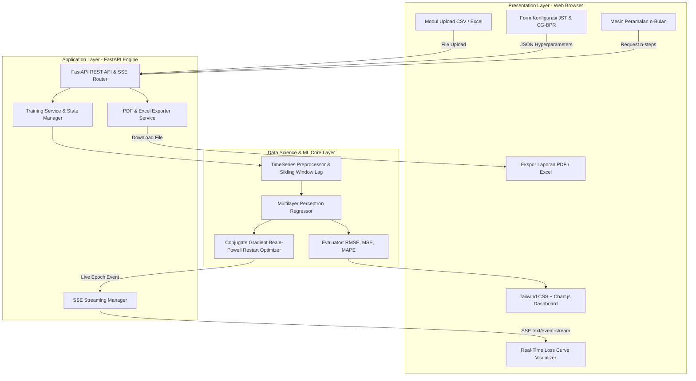

# SIKEL-Gorontalo: Sistem Peramalan Konsumsi Energi Listrik Kota Gorontalo Menggunakan JST Conjugate Gradient Beale-Powell Restart (CG-BPR)

Aplikasi Web Machine Learning Full-Stack untuk meramalkan konsumsi energi listrik bulanan sektor rumah tangga di Kota Gorontalo. Dibangun menggunakan arsitektur modular dengan backend **FastAPI** dan frontend interaktif **Tailwind CSS + Chart.js + Server-Sent Events (SSE)**.

---

## 1. Arsitektur Sistem

Aplikasi ini menggunakan pola arsitektur **Three-Tier Architecture (Client - API/Service - ML Engine)**:



---

## 2. Landasan Matematis & Algoritma

### A. Pembentukan Fitur Lag (Sliding Window Time-Series)
Data deret waktu konsumsi listrik bulanan $y = [y_1, y_2, \dots, y_T]$ dibentuk menjadi pasangan fitur dan target menggunakan jendela geser dengan lag order $p$:
$$X_t = [y_{t-p}, y_{t-p+1}, \dots, y_{t-1}] \in \mathbb{R}^p$$
$$Y_t = y_t \in \mathbb{R}$$

Normalisasi dilakukan ke rentang $[0.1, 0.9]$ untuk mencegah saturasi gradien pada fungsi aktivasi sigmoid:
$$y_{norm} = \frac{y - y_{min}}{y_{max} - y_{min}} \times (0.9 - 0.1) + 0.1$$

### B. Arsitektur Jaringan Saraf Tiruan (JST / Multilayer Perceptron)
- **Input Layer**: $p$ neuron sesuai lag time-series.
- **Hidden Layer**: $n_h$ neuron dengan fungsi aktivasi Sigmoid:
  $$f(z) = \frac{1}{1 + e^{-z}}, \quad f'(z) = f(z)(1 - f(z))$$
- **Output Layer**: 1 neuron dengan aktivasi Linear:
  $$\hat{y} = W^{[2]} a^{[1]} + b^{[2]}$$
- **Fungsi Objektif (Loss)**: Mean Squared Error (MSE):
  $$E(w) = \frac{1}{2N} \sum_{i=1}^N (\hat{y}_i - y_i)^2$$

### C. Optimasi Conjugate Gradient Beale-Powell Restart (CG-BPR)
Algoritma Conjugate Gradient standar memperbarui arah pencarian $d_k$ secara konjugat terhadap Hessian. Namun, pada fungsi non-linear terjadi hilangnya ortogonalitas antar gradien berurutan. Metode **Beale-Powell Restart** memulihkan efisiensi konvergensi dengan kriteria restart cerdas:

1. **Arah Pencarian Awal**:
   $$d_0 = -g_0, \quad \text{di mana } g_k = \nabla E(w_k)$$

2. **Kriteria Restart Powell (Powell, 1977)**:
   Proses restart diaktifkan jika salah satu kondisi berikut terpenuhi:
   - **Kehilangan Ortogonalitas Gradien**:
     $$|g_{k+1}^T g_k| \ge \eta \|g_{k+1}\|^2 \quad (\text{default } \eta = 0.2)$$
   - **Interval Periodik**:
     $$(k + 1) - t \ge \min(N_{restart}, D)$$
     di mana $t$ adalah iterasi restart terakhir dan $D$ adalah dimensi parameter bobot.

3. **Pembaruan Vektor Arah**:
   - Jika **Restart**: simpan arah restart $d_t = d_k$, gradien restart $g_t = g_k$, dan atur arah baru ke *steepest descent*:
     $$d_{k+1} = -g_{k+1}$$
   - Jika **Langkah Normal (Tanpa Restart)**: gunakan formula ekstensi Beale:
     $$d_{k+1} = -g_{k+1} + \beta_k d_k + \gamma_k d_t$$
     dengan parameter konjugat:
     $$\beta_k = \frac{g_{k+1}^T (g_{k+1} - g_k)}{d_k^T (g_{k+1} - g_k)}$$
     $$\gamma_k = \frac{g_{k+1}^T (g_{t+1} - g_t)}{d_t^T (g_{t+1} - g_t)} \quad (\text{untuk } k > t + 1)$$

4. **Line Search Armijo**:
   Langkah pembaruan $\alpha_k$ diperoleh melalui backtracking line search agar memenuhi:
   $$E(w_k + \alpha_k d_k) \le E(w_k) + c_1 \alpha_k g_k^T d_k$$

### D. Metrik Evaluasi Akurasi
- **Mean Squared Error (MSE)**:
  $$\text{MSE} = \frac{1}{N} \sum_{i=1}^N (y_i - \hat{y}_i)^2$$
- **Root Mean Squared Error (RMSE)**:
  $$\text{RMSE} = \sqrt{\text{MSE}}$$
- **Mean Absolute Percentage Error (MAPE)**:
  $$\text{MAPE} = \frac{100\%}{N} \sum_{i=1}^N \left| \frac{y_i - \hat{y}_i}{y_i} \right|$$

---

## 3. Struktur Direktori Proyek

```
project sela/
├── app/
│   ├── api/
│   │   ├── __init__.py
│   │   └── routes.py             # REST API & SSE streaming endpoints
│   ├── ml/
│   │   ├── __init__.py
│   │   ├── ann_cgb.py            # Implementasi JST & Optimizer CG-BPR (Pure NumPy)
│   │   ├── preprocessor.py       # Sliding window & MinMax normalizer
│   │   └── metrics.py            # Kalkulator MSE, RMSE, MAPE
│   ├── services/
│   │   ├── __init__.py
│   │   ├── training_service.py   # State management, training async & forecasting
│   │   └── report_service.py     # PDF (ReportLab) & Excel exporter
│   ├── config.py                 # Konfigurasi path & default hyperparameter
│   └── main.py                   # FastAPI App runner & static mounter
│
├── data/
│   └── gorontalo_listrik_bulanan_2018_2024.csv # Dataset historis Kota Gorontalo (84 data)
│
├── reports/                      # Folder output file PDF & Excel hasil ekspor
├── uploads/                      # Folder penyimpanan file unggahan user
├── static/
│   ├── css/
│   │   └── custom.css            # Custom CSS scrollbars & styling
│   └── js/
│       └── app.js                # Frontend controller, Chart.js & SSE handler
│
├── templates/
│   └── index.html                # Single Page Application Dashboard (Tailwind CSS)
│
├── requirements.txt              # Daftar dependensi Python
├── run.py                        # Script peluncur utama aplikasi
└── README.md                     # Dokumentasi teknis sistem
```

---

## 4. Cara Menjalankan Aplikasi

### Langkah 1: Buat Virtual Environment & Install Dependensi
```bash
# Buat virtual environment
python -m venv venv

# Aktivasi virtual environment:
# Windows (PowerShell):
.\venv\Scripts\Activate.ps1
# Windows (CMD):
.\venv\Scripts\activate.bat
# Linux / macOS:
source venv/bin/activate

# Install dependensi
pip install -r requirements.txt
```

### Langkah 2: Jalankan Server Aplikasi
```bash
python run.py
```
Aplikasi akan aktif di:
- **Aplikasi Web**: [http://127.0.0.1:8000](http://127.0.0.1:8000)
- **Dokumentasi API Swagger**: [http://127.0.0.1:8000/docs](http://127.0.0.1:8000/docs)

---

## 5. Fitur Utama Sistem

1. **Dashboard Time-Series**: Visualisasi interaktif konsumsi listrik historis per bulan beserta metrik ringkasan (Total kWh, Rata-rata, Puncak Pemakaian).
2. **Modul Upload Data**: Mendukung file `.csv`, `.xlsx`, dan `.xls`, serta tombol pemuatan dataset sampel bawaan Kota Gorontalo (2018–2024).
3. **Form Konfigurasi JST**: Pengaturan dinamis jumlah lag window, neuron hidden layer, batas epoch, target error, dan parameter CG-BPR ($N$-interval restart dan $\eta$-Powell threshold).
4. **Visualisasi Loss Real-Time**: Streaming penurunan MSE per epoch secara langsung melalui protokol *Server-Sent Events (SSE)*.
5. **Evaluasi Akurasi**: Tampilan kartu metrik RMSE, MSE, MAPE, serta plot komparasi Data Aktual vs Data Prediksi pada data training dan testing.
6. **Mesin Peramalan (Forecasting)**: Prediksi multi-step rekursif hingga $n$-bulan ke depan dengan visualisasi grafik proyeksi dan tabel rincian bulanan.
7. **Download Laporan**: Ekspor satu klik ke format **CSV**, **Microsoft Excel (.xlsx)**, dan **PDF Dokumen Resmi** siap cetak untuk pelaporan akademik atau operasional PLN.
